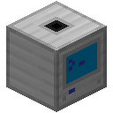
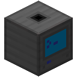

# Digital Items Peripheral Manual

Player-focused documentation and typed APIs for the Digital Items 3 peripherals.
Use these pages whether you write programs directly in CraftOS Lua or compile
TypeScript with TypeScriptToLua.

## Minecraft compatibility

Development supports **1.20.1 Fabric/Forge**, **1.21.1 Fabric/NeoForge**, and
**26.1.2 Fabric/NeoForge**. The peripheral names and Lua/TypeScript APIs are the
same on all three lines. Select the matching Minecraft version in the header.

**Minecraft 26.1.2 requires Java 25 and a new world.** Do not open a 1.20.1 or
1.21.1 world with this version: cross-version world upgrades and downgrades are
not supported. Saving and restarting worlds on the same Minecraft version is
supported. Keep backups and use the JAR for your exact Minecraft version and loader.

## Choose your digitizer

  <a class="di-peripheral-card" href="guides/basic-digitizer/">
    
    <strong>Digitizer</strong><small>Peripheral type: <code>digitizer</code></small>Digitize and restore items through a simple internal inventory.<b>Open peripheral guide &rarr;</b>
  </a>
  <a class="di-peripheral-card di-peripheral-card--advanced" href="guides/advanced-items/">
    
    <strong>Advanced Digitizer</strong><small>Peripheral type: <code>advanced_digitizer</code></small>Move items, fluids, and energy between remote storage and digital IDs.<b>Open peripheral guide &rarr;</b>
  </a>

Both peripherals include the standard CC:Tweaked inventory methods. The advanced
digitizer also exposes configured decay and storage limits through
`getConfiguration()`.

## Start here

- [Getting started](getting-started.md)
- [Digital identifiers](digital-identifiers.md)
- [Basic digitizer guide](guides/basic-digitizer.md)
- [Advanced item guide](guides/advanced-items.md)
- [Fluid and energy guide](guides/fluids-and-energy.md)

The **Guides** explain behavior in player terms and include both Lua and
TypeScript examples. The **API reference** is the precise source for signatures,
overloads, return types, and provider declarations.
